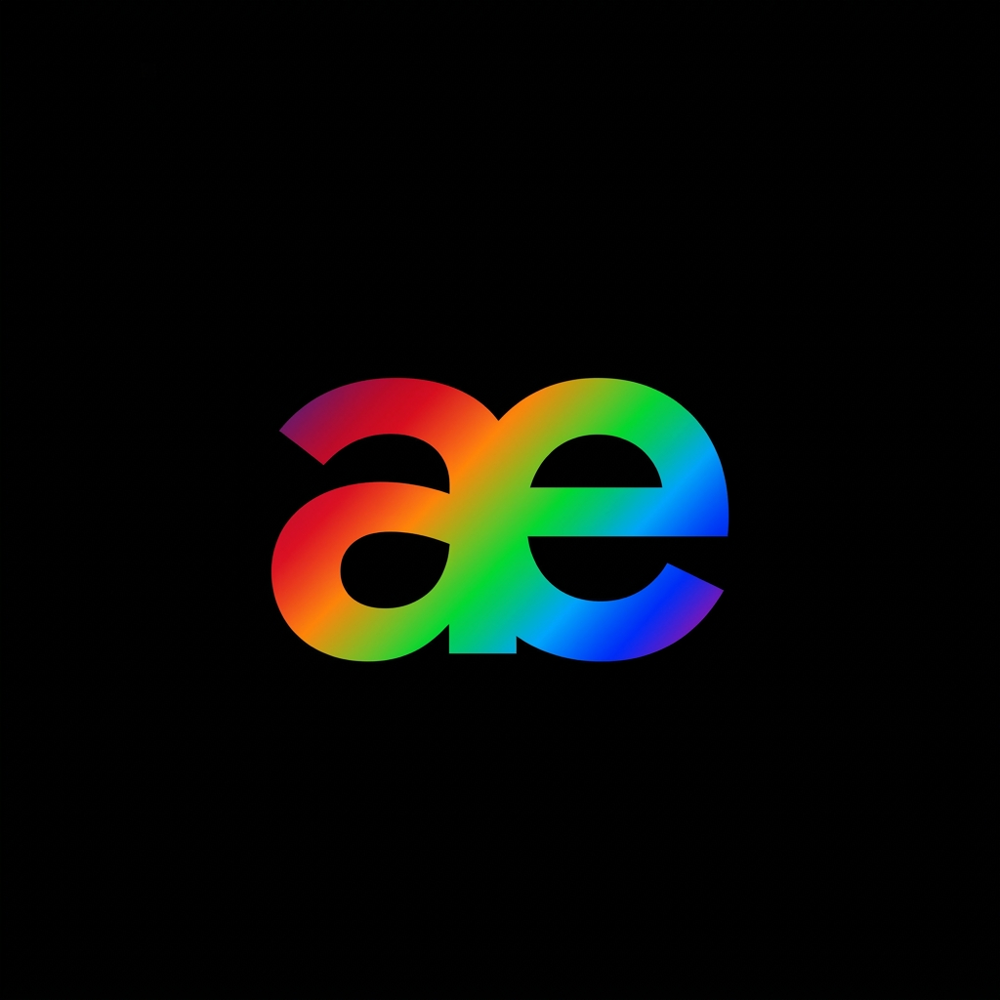

# AEmulator Neo

**Fork [AEmulator Plus](https://github.com/somerandomusernam2/AEmulator-Plus), który jest forkiem [AEmulator Sunset](https://github.com/drel4/AEmulator-Sunset), będącego z kolei forkiem [AEmulator](https://github.com/uxazu/AEmulator). Projekt skupia się przede wszystkim na nowych funkcjach personalizacji i usprawnieniach QoL**

**🇬🇧 [English](../../README.md)** · **🇵🇱 Polski**

---

AEmulator Neo uruchamia rzeczywistego Androida w wersji od 1.0 do 17 bezpośrednio z pliku firmware, który już posiadasz. Aplikacja tłumaczy stary kod ARM za pomocą zmodyfikowanego QEMU, emuluje mechanizm Binder jądra systemu, renderuje grafikę przy użyciu procesora graficznego telefonu i odtwarza dźwięk przez system audio Androida - wszystko działa wewnątrz zwykłej aplikacji.

Projekt powstał niemal w całości z pomocą różnych modeli AI a vanillowy AEmulator, przy wsparciu modelu Opus 5.5.

## Funkcje

- **Import niemal dowolnego formatu firmwaru:** obrazy Android-x86 `.iso`, archiwa CWM/TWRP ZIP, archiwa Samsung Odin `.tar.md5`, obrazy fabryczne Google `.tgz`, pliki `system.img`, aktualizacje OTA `system.new.dat.br`, firmware Motorola `.sbf`, obrazy sparse, obrazy EDL, firmware Spreadtrum `.pac`, obrazy HTC `.nbh`, instalatory HTC `RUU.exe` i wiele innych formatów.
- **Obsługa nakładek producentów:** oryginalne interfejsy działają zgodnie z założeniami, jeśli są kompatybilne, w tym HTC Sense, Samsung TouchWiz, MIUI i AOSP.
- **Sprzętowa akceleracja grafiki** za pośrednictwem mostu GL, obsługa dźwięku, dotyku i multitouch, a także połączenia sieciowe z nowoczesnym serwerem proxy TLS.
- **Współdzielony folder karty pamięci** do przechowywania plików APK, muzyki i zdjęć.
- **Motywy ekranu maszyny wirtualnej i edytor motywów:** pasek nawigacyjny oraz ramka wokół ekranu emulowanego urządzenia mogą korzystać z motywów Original, Sunset, Gingerbread 2.x, Honeycomb 3.x, Holo 4.x i Lollipop 5.x. Możesz też stworzyć własny motyw w edytorze z podglądem na żywo. Dostępne opcje obejmują kształt i rozmiar przycisków, kolory paska, przycisków, stanu wciśnięcia i ramki, efekty poświaty i aureoli, pływający lub płaski pasek, grafikę ramki oraz zaokrąglone narożniki ekranu. Motywy można udostępniać jako pliki `.aetheme`. Funkcja znajduje się w **Ustawienia aplikacji → Wygląd → Motyw ekranu maszyny wirtualnej**.
- **Interfejs Material 3 Expressive** dostępny w 19 językach.
- **Darmowe oprogramowanie open source** na licencji GPL-3.0.

## Szybki start

1. Pobierz plik APK z sekcji [Releases](https://github.com/SzymekTymek991plus81/AEmulator-neo/releases) i zainstaluj aplikację.
2. Otwórz AEmulator Neo, wybierz **Dodaj firmware** i wskaż odpowiedni plik. Import może potrwać kilka minut.
3. Naciśnij **Start**. Pierwsze uruchomienie potrwa dłużej, ponieważ system będzie optymalizował swoje aplikacje.
4. Otwórz menu ⋮, aby uzyskać dostęp do regulacji głośności, przycisku zasilania i logów. Przycisk ⚙️ otwiera ustawienia aplikacji, w tym wybór języka.

## Wymagania

- Android 8.0 lub nowszy na telefonie z 64-bitowym procesorem ARM (`arm64-v8a`).
- Około 500 MB–8 GB wolnego miejsca na każdy firmware.
- **Zalecany procesor Snapdragon** - inne procesory również powinny działać, choć nie ma takiej gwarancji.

## Licencja

GPL-3.0. Android, znaki towarowe i firmware należą do ich właścicieli.

Zobacz [informacje o modyfikacjach wraz z datami](../../NOTICE.md) oraz [otwarty audyt źródeł i licencji](../license-audit.md). Samo oznaczenie projektu jako GPL nie stanowi potwierdzenia, że wszystkie dołączone pliki binarne mają kompletne, odpowiadające im kody źródłowe.
